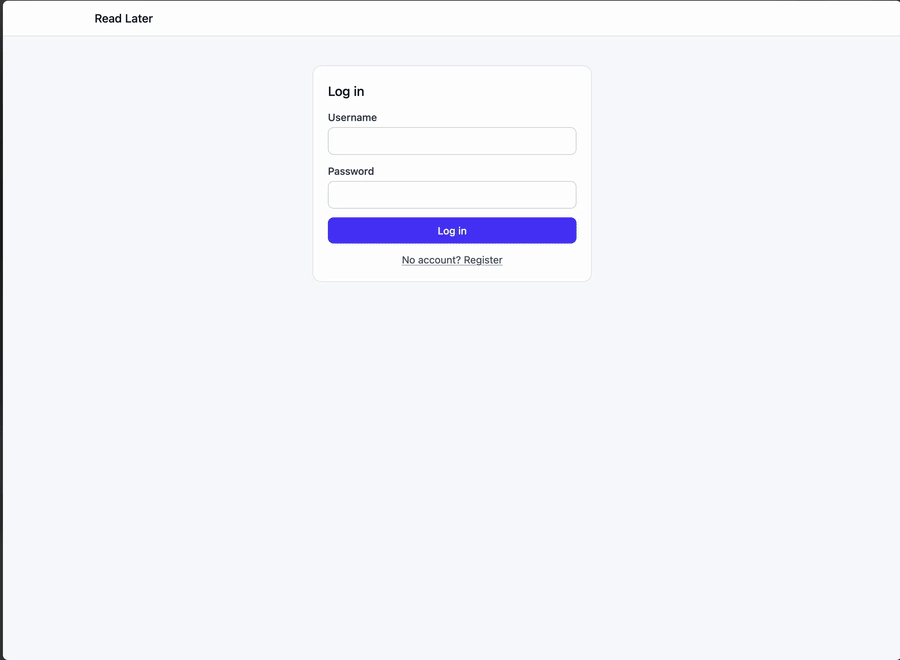

# Read Later

A self-hosted "read it later" app: save a link, and a background worker fetches its title, description and preview image. Built as a learning project to practice production-style full-stack TypeScript: a decoupled SPA and API, a job queue, cache-aside caching, and a layered test suite.



## Features

- Register and log in (JWT, passwords hashed with bcrypt)
- Save a URL with up to 5 tags; it appears instantly as a pending card
- A background worker scrapes the page (`title`, `description`, `og:image`) and the card fills in on its own
- Failed scrapes are shown as such, with a **Retry** action
- Filter the feed by tag
- Delete bookmarks (optimistic UI with rollback on failure)

## Architecture

```text
Browser (React SPA)
      │  REST + JWT
      ▼
Hono API ──► PostgreSQL (Drizzle ORM)
   │  ▲
   │  └── Redis cache (cache-aside, per-user bookmark list)
   ▼
BullMQ queue (Redis) ──► Worker (Cheerio scraper) ──► updates DB + invalidates cache
```

Key ideas:

- **Async processing:** `POST /bookmarks` saves the row with `status: "pending"`, enqueues a scrape job and returns immediately. The worker is a separate process.
- **Cache-aside:** `GET /bookmarks` reads from Redis first and falls back to Postgres. The cache entry is invalidated on create, delete, retry and whenever the worker updates a bookmark. A 1-hour TTL is the safety net.
- **Polling:** while any bookmark is pending, the client refetches every ~3 seconds, so scraped results appear without a reload.

## Tech stack

| Layer          | Technology                                                  |
| :------------- | :---------------------------------------------------------- |
| Frontend       | React, Vite, TypeScript, Tailwind CSS                       |
| API            | Node.js, Hono                                               |
| Database       | PostgreSQL, Drizzle ORM                                     |
| Cache          | Redis                                                       |
| Job queue      | BullMQ                                                      |
| Scraper        | Cheerio                                                     |
| Auth           | JWT, bcrypt                                                 |
| Tests          | Vitest, React Testing Library, MSW, Playwright              |
| Tooling        | pnpm workspaces, ESLint, Prettier, Husky, lint-staged, knip |
| Infrastructure | Docker Compose                                              |

## Getting started

### Prerequisites

- Node.js (a recent LTS)
- pnpm (`npm i -g pnpm`)
- Docker

### Setup

```bash
# 1. Install dependencies
pnpm install

# 2. Start Postgres and Redis
docker compose up -d

# 3. Create server/.env (see "Configuration" below)

# 4. Apply database migrations
pnpm --filter server exec drizzle-kit migrate
```

### Run

Use three terminals:

```bash
pnpm --filter server dev          # API on http://localhost:3000
pnpm --filter server dev:worker   # background scraper
pnpm --filter client dev          # SPA on http://localhost:5173
```

The worker must be running, otherwise new bookmarks stay `pending`.

## Configuration

Server (`server/.env`):

| Variable       | Purpose                    | Default                 |
| :------------- | :------------------------- | :---------------------- |
| `DATABASE_URL` | Postgres connection string | none, required          |
| `SECRET`       | JWT signing secret         | none, required          |
| `PORT`         | API port                   | `3000`                  |
| `REDIS_HOST`   | Redis host                 | `localhost`             |
| `REDIS_PORT`   | Redis port                 | `6379`                  |
| `CORS_ORIGIN`  | Allowed browser origin     | `http://localhost:5173` |

Client:

| Variable       | Purpose      | Default                 |
| :------------- | :----------- | :---------------------- |
| `VITE_API_URL` | API base URL | `http://localhost:3000` |

## API

Protected routes need `Authorization: Bearer <token>`.

| Method | Path                   | Description                                          |
| :----- | :--------------------- | :--------------------------------------------------- |
| POST   | `/register`            | Create an account                                    |
| POST   | `/login`               | Get a JWT                                            |
| GET    | `/bookmarks`           | List the user's bookmarks, with tags                 |
| POST   | `/bookmarks`           | Save a URL (with optional tags) and enqueue a scrape |
| POST   | `/bookmarks/:id/retry` | Re-enqueue a failed bookmark                         |
| DELETE | `/bookmarks/:id`       | Delete a bookmark                                    |

## Testing

```bash
pnpm test        # unit and integration tests (server and client)
pnpm test:e2e    # Playwright end-to-end tests (Firefox)
```

The test suite is layered on purpose:

- **Server:** Vitest against a real `readlater_test` Postgres database, using Hono's `app.request()` to call routes without starting a server. The queue and cache are mocked.
- **Client:** React Testing Library for components, MSW for hooks that call the API.
- **Worker:** the scraping logic is a plain function tested with a mocked `fetch`.
- **End-to-end:** four Playwright "golden paths" (register, save and scrape a bookmark, filter by tag, delete) running the real stack.

The E2E run is isolated from development data. It starts its own API (port 3100), client (5273), a local fixture page to scrape (4000), and uses a separate Redis container (6380) and the `readlater_test` database. State is reset before every test, and the helper refuses to run unless it is pointed at test targets.

Make sure `readlater_test` exists on your Postgres instance and has been migrated before running the tests.

Linting and formatting:

```bash
pnpm lint
pnpm format:check
pnpm knip
```

Husky runs ESLint and Prettier on staged files at commit time. Tests are not run in the pre-commit hook.

## What I learned

- Splitting slow work into a queue and a separate worker process
- Keeping a cache correct: where to invalidate, and why a TTL is still needed
- Validating `unknown` input at the API boundary
- Choosing the right test level: pure functions, route tests, component tests, and only a few E2E tests
- Isolating test data from development data, including Redis

## Roadmap

- Edit tags on existing bookmarks
- Shared TypeScript types between server and client
- More tests: auth routes, cascade deletes, card variants

## License

MIT
